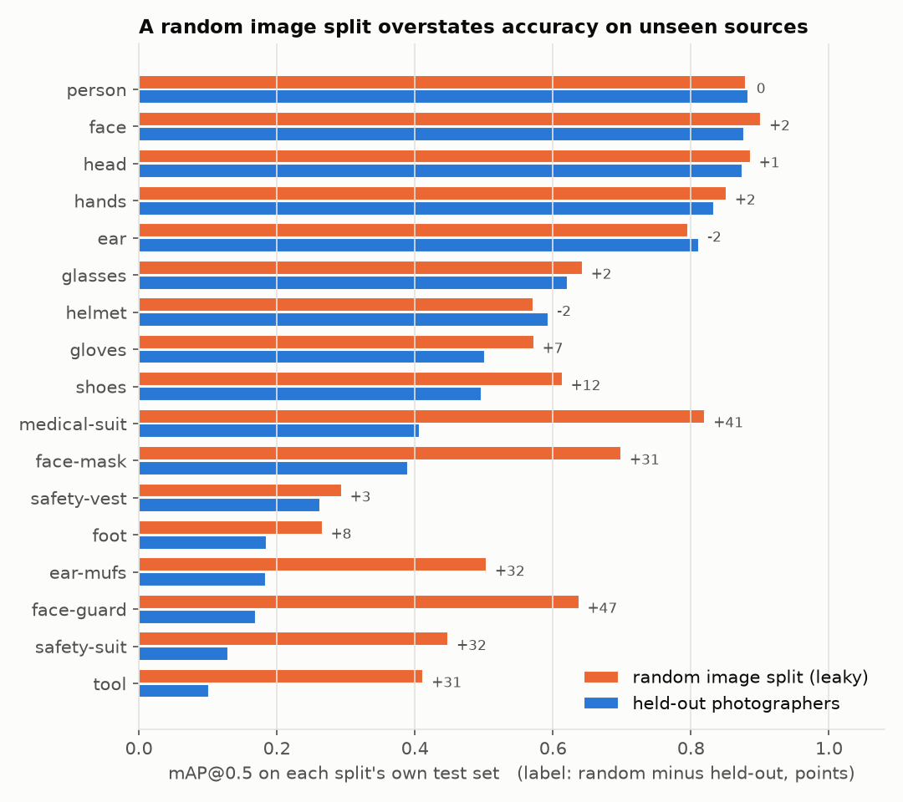
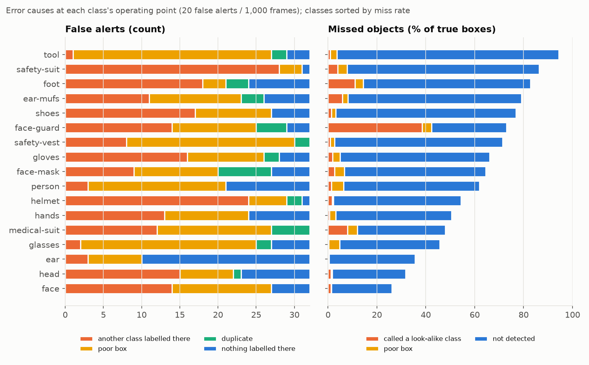
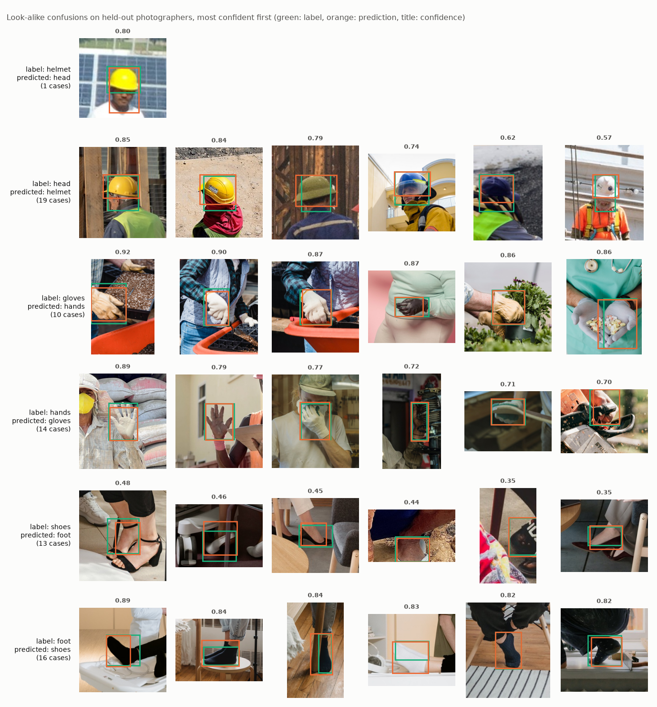
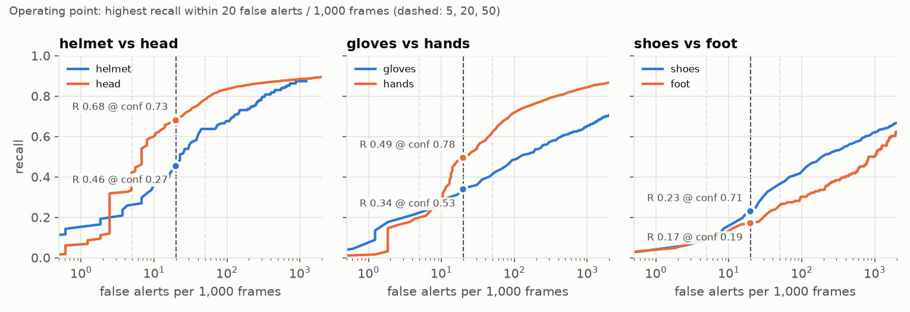

# PPE detection feasibility pilot (SH17 · YOLO26s · TensorRT)

A small, reproducible rehearsal of the first weeks of a vision feasibility study for industrial
safety: fine-tune a detector on real photos of workers, test it on **sources it has never seen**,
pick per-class thresholds from an **alert budget**, and measure what it costs to run on an NVIDIA GPU.

Personal project on public data. It is not based on, and does not describe, any employer's or
customer's data or system.

<!-- narrative:begin -->
**What came out** (test set: 1,628 photos from 307 photographers that never appear in training)

- **Fine-tuned YOLO26s: mAP@0.5 0.490, mAP@0.5:0.95 0.315.** The same recipe on a random image
  split of the same size scores 0.635 — 14.5 points of optimism, concentrated in the rare PPE
  classes (face-guard +47, medical-suit +41, ear-mufs and safety-suit +32), where a few photo
  shoots hold most of the examples. The five most frequent classes move by 2.4 points or less.
- **Operating point from an alert budget.** At 20 false alerts per 1,000 frames, bare hands are
  found 49.5 % of the time at 98 % precision and helmets 46 % at 72 %. Thresholds per class range
  from 0.01 to 0.89 at the same budget, so one global confidence is the wrong knob.
- **Label rules decide a large share of the errors.** An audit of every look-alike case found
  that 12 of the 19 "helmet on a bare head" alerts were real hard hats nobody labelled, and 15 of
  the 16 "bare foot called shoes" errors were feet in socks.
- **TensorRT FP16 on a laptop RTX 5070 Ti:** 1.0 ms per 640-px frame for the network (6.4× faster
  than PyTorch FP32), 2.9 ms with resize and post-processing, 1,426 images/s at batch 8, with
  mAP@0.5 0.489 against 0.490 in PyTorch FP32.
- `python run_all.py` rebuilds all of it. [`docs/feasibility_outline.pdf`](docs/feasibility_outline.pdf)
  turns the method into a one-page outline for a shipyard PPE / fall-detection pilot.
<!-- narrative:end -->

## 1. Problem

A safety team does not buy mAP. It buys alerts it can act on: a missing hard hat or bare hands
flagged at a camera it has never been trained on, without so many false alarms that the
operators mute the system. Three questions decide whether a pilot is worth running:

1. **Does accuracy hold at a new site?** A test set that shares cameras, people or days with the
   training set answers a different, easier question.
2. **What does it cost in false alerts?** Thresholds should come from the number of false alerts
   the safety team can absorb, per class, because a missed violation and a false alarm cost
   different things.
3. **What hardware does it need?** Frames per second per stream and streams per GPU, after the
   model is compiled for the target GPU.

This repository answers all three on public data, as a dry run of the method.

## 2. Data

[SH17](https://github.com/ahmadmughees/SH17dataset) (Ahmad & Rahimi, 2024): 8,099 photos of people
at work in industrial settings, collected from Pexels, with 75,994
boxes in 17 classes — PPE items (helmet, gloves, shoes, safety-vest, safety-suit, medical-suit,
ear-mufs, face-mask, face-guard, glasses), the body parts they protect (head, hands, foot, ear,
face), person and tool. Licence CC BY-NC-SA 4.0. Every image ships with its Pexels record,
including the photographer.

What the labels mean matters as much as the boxes. Measured on the release:

- **helmet is labelled on top of head** — 747 of 927 helmets sit on a head box, so a helmeted head
  carries both labels and "head" alone does not mean "bare head".
- **gloves and hands are exclusive** — only 70 of 2,790 glove boxes overlap a hand box; a bare
  hand is `hands`, a gloved hand is `gloves`. The same holds for `shoes` vs `foot`.

The error analysis below treats a prediction as a look-alike confusion only when no box of the
predicted class is labelled at that spot, so a helmet detected on a helmeted head is never counted
as a confusion with `head`.

The archive is downloaded once (14.2 GB) and re-encoded to a 1280-px long side; no image had a
rotated EXIF orientation and no box was out of range.

## 3. Site-condition split

SH17 has no camera or site ids, so the closest stand-in for "a camera at a new site" is a
**photographer**: one photographer's pictures share places, people, light and lens. The split
holds out whole photographers:

- 922 photographers; the largest (787 photos) and every source above 3 % of the data stays in
  training, so no single studio dominates the test set.
- Groups are assigned greedily, biggest first, to whichever split is furthest below its target
  share of every class, so each class has about 20 % of its images in test.
- Pixel-level near-duplicates across photographers (a 64-bit DCT perceptual hash, Hamming ≤ 6)
  would be merged into one group. The hash found 14 such pairs, all within one photographer, so
  the groups are exactly the photographers. Detector-backbone embeddings were tried first and
  rejected: they rated different photos of similar scenes as near-identical (cosine ≥ 0.95 after
  centring), so they could not tell a re-upload from a look-alike scene.

A **random image split of exactly the same sizes** is kept as the baseline that most tutorials
use. In it, most test images share a photographer with a training image (table below), which is
the frame-level leakage a site test must avoid.

## 4. Model and training

Ultralytics YOLO26s, initialised from its COCO weights, fine-tuned at 640 px, batch 16, 80
epochs, cosine learning rate, default augmentation, seed 0 with deterministic kernels, on a laptop
RTX 5070 Ti (12 GB). The same recipe is trained twice: once on the photographer split, once on the
random split, each with early stopping (patience 20) on its own validation set. The held-out model
stopped at epoch 60 (best 40); the random-split model kept improving on its leaky validation set and
ran all 80.

Training runs in a child process and resumes from its last checkpoint if the GPU faults. On this
Windows laptop, faults (cuDNN execution failure, CUDA out of memory) happened only while another
PyTorch process ran next to training. Every dataloader worker maps the CUDA libraries, so the
likely cause is the Windows commit limit (page-file use peaked at 52 GB). Both reported runs were
trained alone, in one attempt each.

## 5. Results

All numbers in this section are regenerated by `python run_all.py` (the block between the
markers is rewritten from `results/*.json`). Precision / recall / threshold columns are at each
class's operating point (section 6); mAP is threshold-free. The held-out evaluation in this
README was run on the CPU while the GPU trained the baseline; the GPU re-evaluation of the same
weights in the deployment table gives the same mAP (0.4898 / 0.3149 against 0.4897 / 0.3149).

<!-- results:begin -->
### Split

|  | held-out photographers (used) | random images (baseline) |
|---|---|---|
| images (train / val / test) | 5,649 / 822 / 1,628 | 5,649 / 822 / 1,628 |
| photographers in test | 307 | 321 |
| largest photographer's share of test | 7.5% | 9.4% |
| test images whose photographer is also in train | 0.0% | 91.9% |
| test images with a near-duplicate in train | 0.0% | 0.2% |

### Training (YOLO26s from COCO weights, 640 px, batch 16, seed 0)

| model | epochs | best epoch (val mAP@0.5:0.95) | train minutes | resumed after a fault |
|---|---|---|---|---|
| held-out photographers | 60 | 40 | 49.3 | no |
| random images | 80 | 63 | 65.3 | no |

### Headline

| test set | images | mAP@0.5 | mAP@0.5:0.95 |
|---|---|---|---|
| held-out photographers | 1628 | 0.490 | 0.315 |
| random images (leaky) | 1628 | 0.635 | 0.405 |

### Per class (held-out photographers)

| class | test images | instances | mAP@0.5 | mAP@0.5:0.95 | mAP@0.5 random split | threshold @ 20/1k | precision % | recall % |
|---|---|---|---|---|---|---|---|---|
| hands | 1295 | 3281 | 0.833 | 0.569 | 0.852 | 0.78 | 98.1 | 49.5 |
| person | 1510 | 2872 | 0.883 | 0.702 | 0.880 | 0.89 | 97.2 | 38.0 |
| head | 1311 | 2633 | 0.874 | 0.654 | 0.886 | 0.73 | 98.3 | 68.2 |
| face | 1118 | 1889 | 0.878 | 0.660 | 0.901 | 0.71 | 97.8 | 74.0 |
| ear | 954 | 1525 | 0.812 | 0.522 | 0.796 | 0.62 | 96.8 | 64.3 |
| shoes | 317 | 1006 | 0.497 | 0.277 | 0.614 | 0.71 | 87.9 | 23.1 |
| tool | 441 | 704 | 0.102 | 0.058 | 0.412 | 0.60 | 55.6 | 5.7 |
| gloves | 264 | 522 | 0.501 | 0.310 | 0.573 | 0.53 | 84.7 | 33.9 |
| glasses | 320 | 402 | 0.622 | 0.333 | 0.643 | 0.47 | 87.2 | 54.2 |
| helmet | 94 | 182 | 0.594 | 0.356 | 0.571 | 0.27 | 72.2 | 45.6 |
| face-mask | 79 | 149 | 0.390 | 0.208 | 0.699 | 0.28 | 62.4 | 35.6 |
| foot | 70 | 146 | 0.186 | 0.087 | 0.266 | 0.19 | 43.9 | 17.1 |
| safety-vest | 43 | 112 | 0.263 | 0.129 | 0.294 | 0.33 | 50.0 | 28.6 |
| ear-mufs | 45 | 86 | 0.184 | 0.078 | 0.504 | 0.22 | 36.0 | 20.9 |
| safety-suit | 28 | 51 | 0.130 | 0.090 | 0.448 | 0.15 | 17.9 | 13.7 |
| face-guard | 25 | 26 | 0.170 | 0.073 | 0.638 | 0.13 | 17.9 | 26.9 |
| medical-suit | 16 | 25 | 0.407 | 0.249 | 0.821 | 0.01 | 28.9 | 52.0 |

### Look-alike confusions at the operating point

| true class | predicted as | boxes | true boxes in test | share of true boxes |
|---|---|---|---|---|
| helmet | head | 1 | 182 | 0.5% |
| head | helmet | 19 | 2633 | 0.7% |
| gloves | hands | 10 | 522 | 1.9% |
| hands | gloves | 14 | 3281 | 0.4% |
| shoes | foot | 13 | 1006 | 1.3% |
| foot | shoes | 16 | 146 | 11.0% |
| face-mask | face | 2 | 149 | 1.3% |
| face | face-mask | 4 | 1889 | 0.2% |
| face | face-guard | 1 | 1889 | 0.1% |
| safety-vest | safety-suit | 1 | 112 | 0.9% |
| safety-suit | safety-vest | 1 | 51 | 2.0% |
| medical-suit | safety-suit | 1 | 25 | 4.0% |

### Manual audit of the look-alike cases (one reviewer, sheets in `results/audit/`)

| label → predicted | cases | item visible, not labelled | edge of the label rule | model wrong | unclear | not audited |
|---|---|---|---|---|---|---|
| helmet → head | 1 | 0 | 0 | 0 | 1 | 0 |
| head → helmet | 19 | 12 | 0 | 5 | 2 | 0 |
| gloves → hands | 10 | 0 | 0 | 10 | 0 | 0 |
| hands → gloves | 14 | 3 | 0 | 4 | 7 | 0 |
| shoes → foot | 13 | 0 | 9 | 3 | 1 | 0 |
| foot → shoes | 16 | 0 | 15 | 0 | 1 | 0 |

### Where the misses come from

| class | true boxes | found % | called look-alike % | poor box % | not detected % | recall % by size: tiny / small / medium / large |
|---|---|---|---|---|---|---|
| helmet | 182 | 45.6 | 1.6 | 0.5 | 52.2 | 16.9 / 35.1 / 77.2 / 82.3 |
| head | 2633 | 68.2 | 1.2 | 0.5 | 30.0 | 2.6 / 26.6 / 85.0 / 88.0 |
| gloves | 522 | 33.9 | 1.9 | 3.1 | 61.1 | 2.1 / 26.3 / 45.1 / 44.6 |
| hands | 3281 | 49.5 | 0.5 | 2.6 | 47.3 | 0.3 / 15.3 / 62.8 / 70.9 |
| shoes | 1006 | 23.1 | 1.4 | 1.7 | 73.9 | 0.3 / 17.0 / 46.7 / 23.0 |
| foot | 146 | 17.1 | 11.0 | 3.4 | 68.5 | 0.0 / 21.4 / 22.9 / 0.0 |
| safety-vest | 112 | 28.6 | 0.9 | 1.8 | 68.8 | 0.0 / 22.5 / 41.9 / 52.6 |
| person | 2872 | 38.0 | 1.3 | 5.0 | 55.6 | 0.0 / 0.0 / 0.0 / 47.2 |

### Operating points (threshold · precision · recall)

| class | ≤ 5 false alerts / 1k frames | ≤ 20 false alerts / 1k frames | ≤ 50 false alerts / 1k frames | default conf 0.25 |
|---|---|---|---|---|
| helmet | 0.63 · P 86.0 · R 26.9 | 0.27 · P 72.2 · R 45.6 | 0.11 · P 58.9 · R 63.7 | P 70.7 · R 47.8 · 22/1k |
| head | 0.86 · P 99.3 · R 42.2 | 0.73 · P 98.3 · R 68.2 | 0.50 · P 96.2 · R 78.2 | P 92.1 · R 84.1 · 117/1k |
| gloves | 0.72 · P 93.5 · R 22.2 | 0.53 · P 84.7 · R 33.9 | 0.34 · P 73.0 · R 42.0 | P 64.8 · R 46.2 · 80/1k |
| hands | 0.86 · P 98.8 · R 20.2 | 0.78 · P 98.1 · R 49.5 | 0.69 · P 96.2 · R 62.3 | P 82.3 · R 79.6 · 345/1k |
| shoes | 0.81 · P 91.7 · R 8.7 | 0.71 · P 87.9 · R 23.1 | 0.52 · P 82.0 · R 36.6 | P 64.1 · R 48.1 · 166/1k |
| foot | 0.34 · P 63.6 · R 9.6 | 0.19 · P 43.9 · R 17.1 | 0.12 · P 32.5 · R 26.7 | P 53.8 · R 14.4 · 11/1k |
| safety-vest | 0.74 · P 55.6 · R 8.9 | 0.33 · P 50.0 · R 28.6 | 0.13 · P 34.7 · R 38.4 | P 42.5 · R 30.4 · 28/1k |
| person | 0.93 · P 98.0 · R 13.5 | 0.89 · P 97.2 · R 38.0 | 0.75 · P 96.0 · R 68.1 | P 84.1 · R 86.4 · 289/1k |

### Deployment (NVIDIA GeForce RTX 5070 Ti Laptop GPU, TensorRT 10.16.1.11, 640 px)

| format | mAP@0.5 | mAP@0.5:0.95 | model latency ms (b1) | model images/s (b1) | model images/s (b8) | per-frame ms (b1) | FPS (b1) | FPS incl. JPEG decode |
|---|---|---|---|---|---|---|---|---|
| PyTorch FP32 | 0.490 | 0.315 | 6.40 | 156 | – | unstable 59.9–228 | – | – |
| PyTorch FP16 | 0.489 | 0.315 | 6.72 | 149 | 638 | unstable 3.8–6 | – | – |
| TensorRT FP32 | 0.489 | 0.314 | 2.11 | 474 | – | 3.8 | 261 | 100 |
| TensorRT FP16 | 0.489 | 0.314 | 1.00 | 996 | 1426 | 2.9 | 341 | 109 |

Not built in this run: TensorRT INT8 (RuntimeError: RuntimeError: TensorRT engine build failed, check logs for errors)
<!-- results:end -->



### What the split changes

The random split scores 14.5 points higher mAP@0.5 (0.635 against 0.490) with the same model,
recipe and test-set size. The gain is not spread evenly: person, hands, head, face and ear — the
classes with over 1,500 test boxes — move by 2.4 points or less, shoes by 12, and the rare PPE
classes by 31 to 47 (face-guard, medical-suit, ear-mufs, safety-suit, face-mask, tool). Rare
classes come from a few shoots; when those shoots sit on both sides of a random split, the model
is graded on pictures of people and places it has already seen. The rare, safety-relevant
classes are exactly the ones a random split flatters most.





### What the errors are (held-out photographers, at the operating point)

- **Misses dominate, and they are small objects.** For the frequent classes, under 2 % of true
  boxes are called another class (the exceptions are bare feet at 11 %, mostly socks, and the
  rare face-guard, medical-suit and ear-mufs); the rest of the misses are simply not detected.
  Recall falls with size: helmets are found 77–82 % of the time when they are medium or
  large at the 640-px input, 17 % when they are tiny (under 16 px); bare hands 63–71 % against
  under 1 %. Fixed cameras look down from far away, so input resolution or tiling per camera is
  the first lever, before any change of model.
- **Most look-alike "errors" are questions for the label rules.** I checked every look-alike case
  by eye (sheets in [`results/audit/`](results/audit/), verdicts in
  [`results/audit_verdicts.json`](results/audit_verdicts.json)):
  - head called helmet (19): **12 show a real hard hat that nobody labelled**; 5 are caps, bucket
    hats or a bare head; 2 are unclear.
  - bare foot called shoes (16): 15 are **feet in socks**, which SH17 labels as foot.
  - shoes called bare foot (13): 9 are open heels or sandals that show skin; 3 are real misses
    (two sneakers and a boot).
  - gloves called bare hands (10): all 10 are real misses — tan, white, black and latex gloves.
  - bare hands called gloves (14): 3 gloves were not labelled, 4 are real errors, 7 are too
    small to call.

  On a shipyard a sock or a sandal is a footwear violation whatever the class is called, and a
  hard hat has to be labelled every time it is visible. The rule book, not the model, decides
  about half of these numbers, which is why the feasibility outline asks for written label rules
  and an audit sample before any accuracy is promised.
- **Errors cluster by source.** Two photographers account for 13 of the 16 sock cases, and one
  gardening shoot for 6 of the 10 missed gloves. A site study should report results per camera, not only in
  total.
- **Rare and vague classes are not ready.** face-guard, safety-suit, ear-mufs, foot and tool
  stay below 0.2 mAP@0.5 with 26–704 test boxes each; tool is a catch-all class.

## 6. Operating point

Every prediction down to confidence 0.001 is matched to the labels (IoU ≥ 0.5, greedy by
confidence, the same rule as COCO), using the validator's own predictions so the analysis and
the mAP describe the same boxes. For each class this gives recall against **false alerts per
1,000 frames**. The operating point is the lowest threshold that stays within the budget
(default 20 / 1,000 frames; 5 and 50 are reported too).



What the budget buys on held-out photographers (full table above):

- At **20 false alerts per 1,000 frames**, bare hands are found 49.5 % of the time at 98 %
  precision, heads 68 %, helmets 46 % at 72 % precision, gloves 34 % at 85 %.
- Relaxing to 50 / 1,000 lifts helmet recall to 64 % (precision 59 %) and bare hands to 62 %;
  tightening to 5 / 1,000 drops bare hands to 20 %.
- The usual default, confidence 0.25, would find 80 % of bare hands but raise 345 false alerts per
  1,000 frames — the setting an operator mutes after a day.
- Thresholds differ a lot between classes (0.27 for helmet, 0.78 for bare hands at the same
  budget), so one global confidence threshold is the wrong knob.

How a budget per 1,000 frames maps to a shift depends on the site: at one analysed frame every
10 s, an 8-hour shift is about 2,900 frames per camera. A real system would also confirm an alert
over k of n frames and de-duplicate per track, which cuts raw false alerts further; photos cannot
measure that, video from the site can.

## 7. Deployment

The fine-tuned model is exported to ONNX (36 MB) and to TensorRT 10.16 engines (FP32, FP16,
FP16 at batch 8), and each format is re-evaluated on the same test split so speed and accuracy
are reported together. Each format is measured in a fresh process. "Model" columns time the
network alone on a GPU tensor (median of 5 rounds of 100 calls); "per-frame" adds letterbox and
post-processing as Ultralytics measures them on 300 test photos at a fixed 640×640 input; the
last column also counts reading and decoding the 1280-px JPEG on one CPU thread.

- **Accuracy survives the compile.** TensorRT FP16 scores mAP@0.5 0.489 / mAP@0.5:0.95 0.314
  against 0.490 / 0.315 for PyTorch FP32.
- **Network latency at batch 1:** 1.00 ms TensorRT FP16, 2.11 ms TensorRT FP32, 6.40 ms PyTorch
  FP32. PyTorch FP16 is no faster than FP32 at batch 1 (6.72 ms): eager mode is bound by kernel
  launches, not arithmetic, while TensorRT fuses the graph. At batch 8, TensorRT FP16 runs
  1,426 images/s against 638 for PyTorch FP16.
- **Per frame:** 2.9 ms (341 FPS) for TensorRT FP16 with resize and post-processing. Adding the
  JPEG decode on one CPU thread brings it to about 109 FPS, so the CPU becomes the limit; camera
  streams would use the GPU's hardware video decoder instead.
- **Streams per GPU:** 1,426 images/s at 5 analysed frames per second per camera is a ceiling of
  about 285 streams on this laptop GPU, before video decoding, tracking and alert logic are
  counted. It bounds the sizing; it is not the sizing.
- **PyTorch per-frame timings were unstable on this laptop.** With the same fixed-size input, the
  FP32 model's inference step took 2.6–3.7 ms per frame in some processes and 60–230 ms in others, while the
  model-only loop, which keeps the GPU busy, varied by under 1 %. Laptop GPU power management
  under bursty batch-1 load is the likely cause; it was not pinned down, so the table shows the
  spread instead of a number. TensorRT rounds stayed between 2.9 and 3.9 ms.
- **INT8 was not built.** TensorRT 11 dropped the FP16 / INT8 builder flags, so with TensorRT
  11.4 (tried first) Ultralytics builds reduced-precision engines only through NVIDIA ModelOpt;
  the run pins TensorRT 10.16 instead. There, Ultralytics' INT8 calibration build
  stops with an internal TensorRT (Myelin) error — no kernel for one fused quantized node — and
  was not pursued further.

`docker/` packages inference as a container: it builds the TensorRT engine for whatever GPU it
starts on (engines are tied to the GPU and TensorRT version), applies the per-class thresholds
from `results/group/operating_points.csv`, and writes one JSON line per frame.

```bash
docker build -f docker/Dockerfile -t ppe-detector:0.1 .
docker run --rm --gpus all -v ./samples:/data/in -v ./out:/data/out -v ppe-trt:/app/cache ppe-detector:0.1 --source /data/in --out /data/out
```

**The image has not been built or run**: the development PC has no Docker. It starts from the
official `ultralytics/ultralytics:8.4.202` GPU image and needs the NVIDIA Container Toolkit. It
copies `models/ppe_yolo26s_sh17_group.pt`, which `python run_all.py` writes; the weights are not
in the repository (section 10).

## 8. Limitations

- **Stock photos, not CCTV.** Pexels pictures are well lit, well framed and often posed; fixed
  cameras look down from far away, at night, in rain and through welding glare. These numbers
  are a method check, not a forecast for a shipyard.
- **Photographer is a proxy for site.** It removes shared people and places, but two
  photographers can still shoot similar scenes.
- **No falls, no video.** SH17 has no fall class and no frame sequences, so temporal confirmation,
  tracking and fall-vs-kneeling cannot be measured here.
- **No zero-shot baseline.** A prompted open-vocabulary model on the same test set would show what
  fine-tuning buys; it is not part of this run.
- **One seed, one model size.** Differences of a point or two between classes or formats are
  within run-to-run noise.
- **Laptop GPU.** Clocks depend on power and temperature; server or Jetson numbers will differ,
  and PyTorch per-frame timings on this machine were not reproducible (section 7).
- **No INT8 numbers.** The INT8 engine build failed in TensorRT 10.16 (section 7).
- **One reviewer.** The look-alike audit was done by one person from crops at the operating
  point; a second, independent pass would be needed before quoting it as a label-error rate.

## 9. Reproduce

```bash
uv venv --python 3.12 .venv
uv pip install torch==2.11.0 torchvision==0.26.0 --index-url https://download.pytorch.org/whl/cu128
uv pip install -r requirements.txt --extra-index-url https://pypi.nvidia.com
python run_all.py
```

`run_all.py` downloads SH17 from Kaggle's public API (14.2 GB; no account was needed at the time
of writing), writes the 1280-px copy, builds both splits, trains both models, evaluates them,
exports ONNX / TensorRT, benchmarks every format, and rebuilds the figures, this README's result
block and `docs/feasibility_outline.pdf`. Each finished step is skipped on a re-run;
`--only report` rebuilds only the outputs. Heavy files (venv, data, runs, engines) go to
`%PPE_WORK%` (default `~/ml-work/ppe-detection-feasibility`). Ultralytics' automatic package
installs and usage analytics are switched off.

```
run_all.py            single entry point
ppe/data.py           download, safe extract, resize, Pexels metadata
ppe/split.py          photographer-held-out split, perceptual-hash near-duplicates, random baseline
ppe/train.py          fine-tuning in a child process with resume-on-fault
ppe/evaluate.py       matching, per-class metrics, error causes, look-alike table, operating points
ppe/deploy.py         ONNX / TensorRT export, accuracy per format, latency and throughput
ppe/figures.py        README figures
ppe/report.py, pdf.py result tables, README block, one-page feasibility outline
docker/               inference container (not built here)
results/              metrics JSON / CSV and figures
models/               fine-tuned weights (.pt, .onnx), written by run_all.py, not in the repository
docs/                 feasibility_outline.pdf
```

## 10. Licences and attribution

- Code in this repository: [AGPL-3.0](LICENSE), the licence of Ultralytics, which it builds on.
- Data: SH17, H. M. Ahmad and A. Rahimi, *SH17: A Dataset for Human Safety and Personal
  Protective Equipment Detection in Manufacturing Industry*, arXiv:2407.04590 (2024) —
  [CC BY-NC-SA 4.0](https://creativecommons.org/licenses/by-nc-sa/4.0/); images from Pexels.
  The figures that show crops of SH17 photos (`results/figures/lookalike_examples.png`,
  `results/audit/*.png`) are shared under the same CC BY-NC-SA 4.0 terms.
- Model: Ultralytics YOLO26 (AGPL-3.0). The fine-tuned weights are not distributed, because they
  would carry both the AGPL-3.0 terms of Ultralytics and the non-commercial terms of SH17.
  `python run_all.py` trains them again: 49 minutes for the held-out model on a laptop
  RTX 5070 Ti, plus 65 for the random-split baseline (`--no-random-baseline` skips it).
